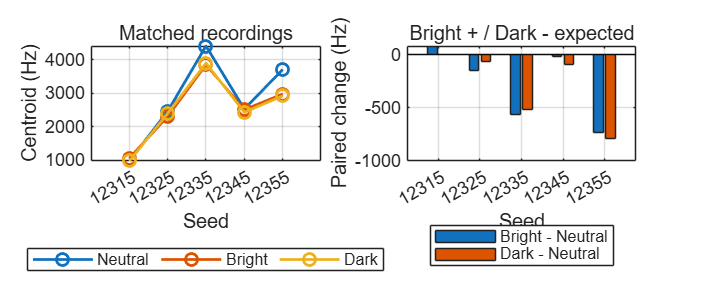
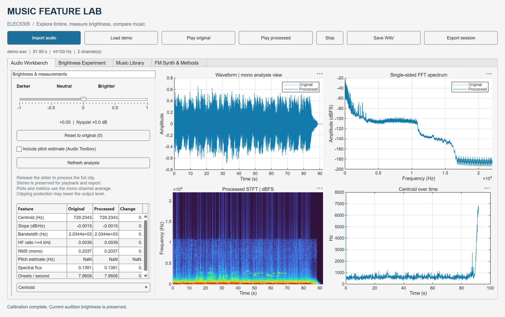
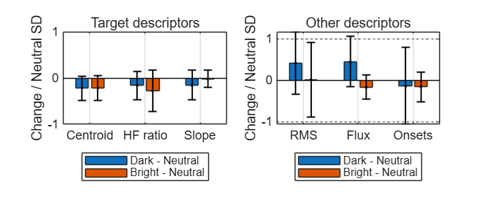

# Music Feature Lab

**An acoustic audit of brightness prompts, with an integrated MATLAB App.**

Zihang Wang · ELEC5305 · SID 560746563 · 3 November 2026

[Project website](https://efwell-1106.github.io/elec5305-project-560746563/) ·
[Project report (PDF)](Report/Project_Report.pdf) ·
[Project report (Word)](Report/Project_Report.docx) ·
[Summary Live Script](Analysis/Video_Walkthrough.mlx)

## Research question and findings

For one instrumental electronic-music prompt family, do Bright and Dark
instructions produce consistent acoustic changes across matched seeds, and
how much do unrequested attributes change?

Two complementary experiments are included:

- **DSP reference:** apply a symmetric FFT-domain spectral tilt to one fixed
  recording at nine settings, from -1 to +1 in steps of 0.25. Centroid and
  high-frequency energy ratio increase at every step for this recording.
  The remeasured full-band slope becomes more negative. This is an acoustic
  calibration, not a perceptual scale or a matched generative benchmark.
- **Generated-music audit:** analyze 15 retained ACE-Step recordings, with
  Neutral, Bright and Dark conditions for each of five seeds. Bright raises
  centroid versus Neutral in **1/5** pairs; Dark lowers it in **5/5**, with
  one decrease only about **0.52 Hz**. HF ratio follows the expected direction
  in **2/5** pairs for each condition. Other descriptors also vary across seeds.

These descriptive results do **not** establish selective or perceptually
verified brightness control, and cannot be generalized to all generators.
No significance test or listening study is reported. See
[data provenance and limitations](DATA_PROVENANCE.md).



## Run the App

1. Download the repository using **Code → Download ZIP**, then extract it.
2. Open the extracted repository folder in MATLAB.
3. Run:

```matlab
run_project
```

Alternatively, open `MusicFeatureLab/MusicFeatureLabApp.mlapp` in App Designer
and run it. Keep the directory structure intact.

The App includes:

| Page | Purpose |
| --- | --- |
| Audio Workbench | Import, original/processed playback, waveform, FFT, STFT and descriptors |
| Brightness Experiment | Nine-level DSP sweep on the currently loaded recording |
| Music Library | Batch analysis of Neutral/Bright/Dark recordings and condition summaries |
| FM Synth & Methods | Optional test-tone synthesis and measurement notes |

The App analyzes existing audio locally. It does **not** invoke ACE-Step or
generate new AI music. DSP processing is offline, not real-time streaming.



## Reproduce the measurements

Run the full audio-analysis pipeline:

```matlab
run_experiments
```

This recomputes the source analysis, nine-level calibration, library
measurements, historical filename-seed contrasts, FM demonstration and
numerical checks. Outputs are written to `results/`.

Then reproduce the new Neutral-referenced paired tables and plots:

```matlab
run_summary_analysis
```

The summary script reads measurement CSVs in `Analysis/data/`; it does not
reanalyze WAV files. To refresh it after changing input audio, first run
`run_experiments`, replace `Analysis/data/library_features.csv` and
`Analysis/data/calibration.csv` with the corresponding newly generated
files in `results/`, then rerun the summary. Exported paired CSVs and figures
in this repository are the retained outputs and are not automatically
overwritten by the presentation script.

For the full code-and-output report, open `Report/Experiment_Live.mlx` and
select **Run All**. For the concise interpretation, open
`Analysis/Video_Walkthrough.mlx`; it includes saved outputs and optional
speaking cues. It is a Live Script, not a video.

The project was verified in **MATLAB R2026a Update 4** on Windows. Core
analysis uses custom implementations and does not require optional toolboxes.
The optional `pitch` feature uses Audio Toolbox; pitch is disabled in the main
experiments and excluded from the prompt comparison. No Python service,
model installation or internet connection is required for the supplied
MATLAB experiments. GitHub Pages displays the project; it does not run MATLAB.

To run the eight numerical test groups separately:

```matlab
addpath('MusicFeatureLab', fullfile('MusicFeatureLab','tests'));
run_music_analysis_tests;
```

## Interpret the paired figure



Bars are mean condition-minus-Neutral differences for matching seeds.
Error bars are ±1 sample SD of the five paired differences. For the normalized
figure, both means and SDs are divided by Neutral's cross-seed SD.
The ±1 reference lines are descriptive, not significance thresholds.
RMS is signal amplitude, not perceptual loudness; onset rate is a detector
output, not musical tempo. Finite pitch estimates are not accuracy scores.

## Files

```text
run_project.m                  Start the integrated App
run_experiments.m              Recompute audio measurements and checks
run_summary_analysis.m         Recreate paired summaries from measurement tables
MusicFeatureLab/               App, shared code, WAV data, tests and source backup
Report/Project_Report.pdf      PDF exported from the latest saved Word report
Report/Project_Report.docx     Latest saved written report
Report/Experiment_Live.*       Full baseline experimental code and saved outputs
Analysis/                     Latest paired analysis and summary Live Script
results/                      Measurements and verification records
assets/                       Website figures and App screenshots
Legacy/                       Earlier repository files, retained for provenance
AI_USAGE_DECLARATION.txt       Disclosed AI assistance
DATA_PROVENANCE.md             Generation records, recollection and limitations
VIDEO_STATUS.md                Video status and remaining link work
SHA256SUMS.csv                 Checksums for current project files
```

The `Legacy/` files use earlier methods and may contain old paths or Chinese
comments. They are preserved originals, not the current runnable entry points.
Do not mix their feature values with the current results. The former root
README and website are archived there as part of that history.

## Project video

**Video pending.** The recording/link has not yet been supplied. It will be
added to this README, the website and the report when ready. The website does
not present a placeholder as a completed submission.

## References and software sources

The written report contains the timbre-perception references and MathWorks
documentation supporting its descriptor discussion:

- [Caclin et al. (2005), acoustic correlates of timbre-space dimensions](https://doi.org/10.1121/1.1929229).
- [Kazazis et al. (2021), ordinal scaling of spectral descriptors](https://doi.org/10.1121/10.0005058).
- [Kazazis et al. (2022), interval and ratio scaling](https://doi.org/10.3389/fpsyg.2022.835401).
- [MathWorks spectralCentroid](https://www.mathworks.com/help/audio/ref/spectralcentroid.html) and
  [pitch](https://www.mathworks.com/help/audio/ref/pitch.html).

Generator source: [ACE-Step official repository](https://github.com/ace-step/ACE-Step)
and [ACE-Step paper](https://arxiv.org/abs/2506.00045). The exact version used
for the retained generation is unverified; citing the project does not
identify an installed checkpoint. [MusicGen](https://arxiv.org/abs/2306.05284)
is relevant background, not a model tested in this project.

## AI assistance

I selected the topic, ran the original audio generation and manually wrote
the original MATLAB code with AI guidance. ChatGPT and OpenAI Codex assisted
with experimental design, code development and debugging, App integration,
analysis interpretation, material organization, report drafting/revision and
language editing. Codex also assisted this repository and website update.
ACE-Step generated the experimental audio. Exact historical model versions
were not retained. See [the report's AI declaration](AI_USAGE_DECLARATION.txt)
and [data provenance](DATA_PROVENANCE.md).
